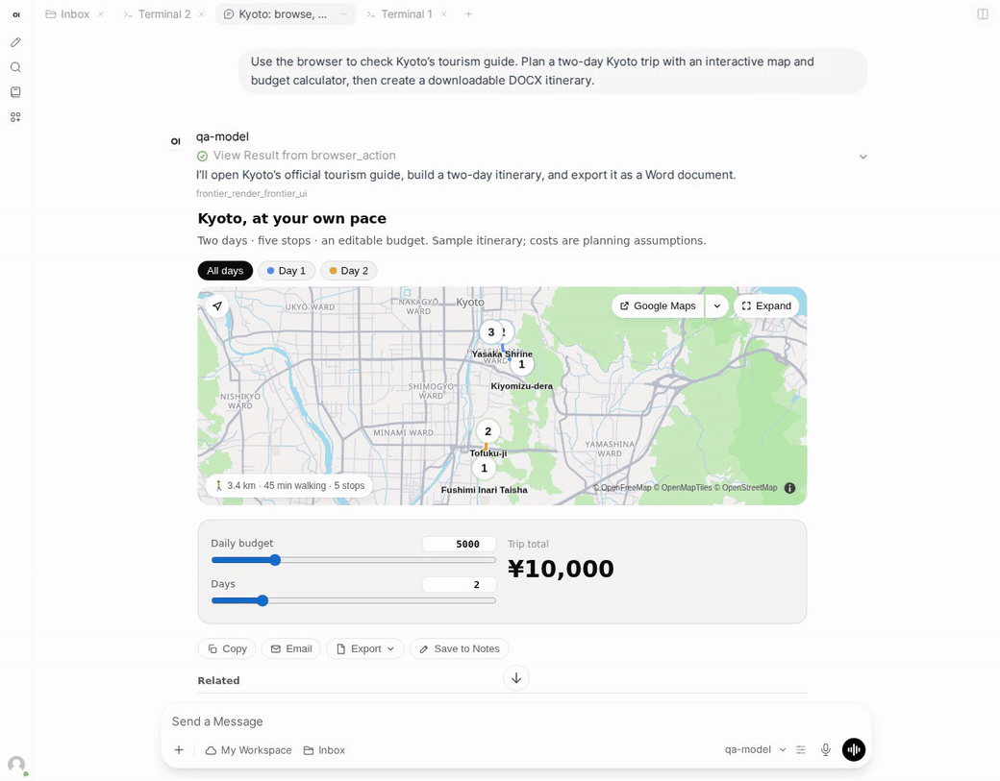
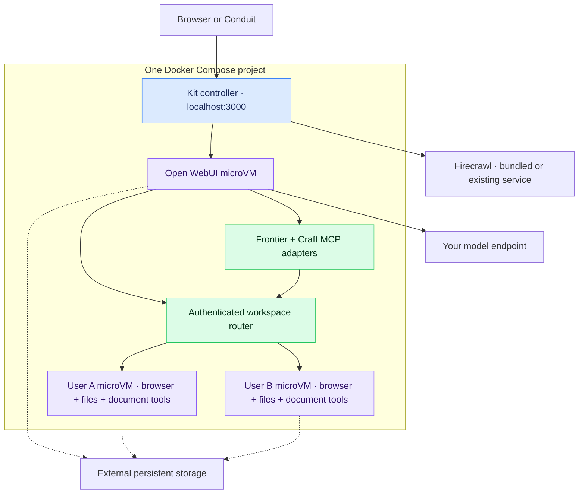

<div align="center">

# ✦ WebUI Sandbox Kit

### Turn your Linux server into a personal AI workspace.

Chat, research, browse, create documents, and build interactive answers.<br>Your model gateway. Persistent files. A separate microVM for each approved user.

<p>
  <a href="https://github.com/d4em0n/webui-sandbox-kit/actions/workflows/ci.yml"></a>
  <a href="#quick-start"></a>
  <a href="docs/architecture.md"></a>
  <a href="LICENSE"></a>
</p>

**[Get started](#quick-start) · [See the architecture](#how-it-fits-together) · [Read the docs](#explore-the-docs) · [Track improvements](https://github.com/d4em0n/webui-sandbox-kit/issues)**

</div>

---

A reproducible stack built around **[Open WebUI][open-webui]**,
**[Microsandbox][microsandbox] / [libkrun][libkrun]**, **[Open Terminal][open-terminal]**,
**[Frontier UI][frontier-ui]** through **[MCP Apps][mcp-apps]**, **[Firecrawl][firecrawl]**,
and **[WordCraft][wordcraft] / [PdfCraft][pdfcraft] / [DeckCraft][deckcraft]**.

This started as my personal homeserver setup. The same repository now builds the stack
I use, with private accounts, credentials, files, and configuration stored outside the image.
Use it as a starting point for your own self-hosted assistant.

## See it in action

**One chat: browse → plan a Kyoto trip → create a DOCX → explore your workspace.**



<!-- Captured 2026-11-15 in a disposable kit installation with official locked images,
     a sample account, a scripted QA model and real browser/Frontier/WordCraft tools.
     The continuous light-theme walkthrough explores the completed tool run, then
     opens the right sidebar's terminal, Inbox and DOCX preview. Startup is trimmed;
     no personal data is used. Visible map attribution remains in the recording. -->

## What's inside

| | Experience | Powered by |
| :---: | --- | --- |
| 💬 | **Chat that remembers** — conversations, notes, document knowledge, memory, and scheduled tasks. | [Open WebUI][open-webui] |
| 🧭 | **Interactive answers** — maps, routes, galleries, charts, calculators, and controls. | [Frontier UI][frontier-ui] + [MCP Apps][mcp-apps] |
| 🌐 | **Browse and research** — a sandboxed Chromium browser plus web search and page scraping. | [Open Terminal][open-terminal] + [Firecrawl][firecrawl] |
| 📄 | **Create documents** — Word, PDF, and PowerPoint tools, with downloadable Frontier exports. | [WordCraft][wordcraft] · [PdfCraft][pdfcraft] · [DeckCraft][deckcraft] |
| 🧑‍💻 | **A workspace for each user** — persistent files, code execution, and a terminal in its own microVM. | [Microsandbox][microsandbox] + [Open Terminal][open-terminal] |
| 💾 | **Keep your state** — external storage, persistent secrets, restart recovery, and verified backup/restore commands. | Kit controller |

Bring your own **OpenAI-compatible model endpoint and credentials**. Model access and billing
come from your provider. Memory and other model-driven features depend on its capabilities.
Craft apps run as headless engines; their full desktop editors are not streamed.

## Quick start

### 1. Check your host

You'll need **Linux x86_64**, working **`/dev/kvm`**, [Docker Engine][docker] with **[Compose v2+][compose]**,
**Python 3.12+**, and **`iproute2`**. Ubuntu with rootful Docker is the tested starting point.

### 2. Start your stack

Keep your provider key in a file outside the checkout, then run:

```sh
git clone https://github.com/d4em0n/webui-sandbox-kit.git
cd webui-sandbox-kit

./kit init \
  --provider-url https://api.openai.com/v1 \
  --provider-key-file /path/to/api-key \
  --model YOUR_MODEL_ID

./kit up
```

### 3. Make it yours

Open **http://localhost:3000** and create the first administrator account. Public signup
closes afterward; add or approve other users in the admin UI. Their private workspace is
created on first use and reused across chats.

First boot verifies pinned downloads, pulls the official application images, and starts
the microVMs. Allow several minutes; **`./kit logs`** shows progress.

> [!TIP]
> Already using port 3000? Add `--port 3300` to `./kit init`.
> Choose your storage location with `--data-dir /srv/assistant-data`.
> For a remote server, use an SSH tunnel or your own reverse proxy to reach the localhost listener.

## How it fits together

[Docker Compose][compose] runs the trusted controller. **[Microsandbox][microsandbox] / [libkrun][libkrun]
runs Open WebUI and the user workspaces in microVMs**, using the official OCI images. The integration code lives in
adapters and launchers; Open WebUI and Open Terminal core code stays unpatched.



Only the controller receives `/dev/kvm`. User VMs mount their own workspace and credentials;
private networks, host services, and cloud metadata remain blocked from those workspaces.
The controller runs without privileged mode or a Docker socket.

[Explore the security boundaries →](docs/architecture.md)

Thanks to these upstream projects and [libkrunfw][libkrunfw] for the foundations.
Exact supported versions and digests live in [the version lockfile](versions.lock.json);
licenses and attribution are collected in [third-party notices](THIRD_PARTY_NOTICES.md).

## Choose your web-search setup

**Bundle it, reuse it, or leave it off.** Firecrawl is optional.

<details>
<summary><strong>Use the bundled Firecrawl stack</strong> — the default</summary>

`./kit init` includes Firecrawl with its own browser, PostgreSQL, Redis, and RabbitMQ
services. They stay on the stack's Docker network without published host ports.

</details>

<details>
<summary><strong>Connect an existing Firecrawl service</strong></summary>

```sh
./kit init \
  --firecrawl-url https://search.example.com \
  --firecrawl-key-file /private/firecrawl-key
./kit up
```

Use the API root without `/v1` or `/v2`. The key is optional for an unauthenticated
self-hosted service. For another Docker stack, add `--firecrawl-network NETWORK` and
use the service's address on that network. External mode does not start bundled sidecars.

</details>

<details>
<summary><strong>Run without Firecrawl</strong></summary>

```sh
./kit init --no-firecrawl
./kit up
```

This disables the kit's Firecrawl web-search integration. Native workspace/browser tools
remain available.

</details>

See [configuration](docs/configuration.md) for service networking, credentials, and switching modes.

## Take it with you

I use **[Conduit on iOS](https://github.com/cogwheel0/conduit)** alongside the web interface.
Connect it to your own WebUI URL and account for a native mobile client.

Conduit is installed separately. Widget actions and file previews depend on the client
version; a server update does not update the app. My client-fork work and current limitations
are documented in [the personal setup guide](docs/personal-setup.md).

## Size your starting point

| Component | Default allocation |
| --- | --- |
| Open WebUI microVM | 4 vCPUs · 4 GiB RAM |
| Each user workspace | 2 vCPUs · 2 GiB RAM |
| Initial capacity | 2 user workspaces · 10 GiB controller memory limit |
| Complete host with bundled Firecrawl | Plan for roughly 16 GiB RAM, plus substantial disk space for images and state |

Raise the controller/host budget alongside `max_users`. Reusing external Firecrawl or
reducing VM allocations can suit smaller hosts. First boot needs internet access to the
pinned registries and download sources. Other architectures and rootless Docker remain unverified.

## Everyday commands

```sh
./kit doctor                            # Check Linux, KVM, Docker, and Compose
./kit status                            # Inspect this stack
./kit logs                              # Follow controller output
./kit stop                              # Stop this installation
./kit up                                # Start again with persistent state
./kit backup                            # Pause, archive, verify, and resume
./kit verify-backup /path/to/backup.tar.gz
./kit update                            # Back up and rebuild this checkout's pins
./kit down                              # Remove stack containers/network; retain data
```

Instance settings live in **`DATA_DIR/controller/config/settings.json`**. Model credentials
stay in the protected **`provider-key`** file. Kit-owned connections are reconciled on startup;
other WebUI settings remain in its database. Resource changes initially apply to new user VMs.

Set your own public URL for a reverse proxy, or explicitly allow a private model gateway
with `--allow-private-provider`. The kit does not configure your DNS or reverse proxy.
An unused Docker subnet is selected automatically; `--subnet` provides an explicit override.

## Built in the open

Corrections are saved in the [customization ledger](docs/customizations.md), with their
owning component and regression evidence. The [verification record](VERIFICATION.md)
separates unit tests, real integration checks, and untested platforms.

Current compatibility work:

- [**Image-heavy requests and provider size limits**](https://github.com/d4em0n/webui-sandbox-kit/issues/1)
- [**Conduit Office previews through server PDF conversion**](https://github.com/d4em0n/webui-sandbox-kit/issues/2)

Found something? [Open an issue](https://github.com/d4em0n/webui-sandbox-kit/issues/new/choose)
with your versions and a synthetic reproduction. Our [contribution workflow](CONTRIBUTING.md)
keeps kit fixes and related upstream reports connected.

## Explore the docs

| Start here | Go deeper |
| --- | --- |
| [Configuration & storage](docs/configuration.md) | [Architecture & isolation](docs/architecture.md) |
| [Operations & recovery](docs/operations.md) | [Features & client limits](docs/limitations.md) |
| [Personal setup & iOS](docs/personal-setup.md) | [Customization ledger](docs/customizations.md) |
| [Migrate an existing setup](docs/migration.md) | [Upstream source & patch policy](docs/upstream-maintenance.md) |
| [Testing & development](docs/testing.md) | [Verification results](VERIFICATION.md) |
| [Publishing your variation](docs/publishing.md) | [Third-party notices](THIRD_PARTY_NOTICES.md) |

---

The kit's integration code is **MIT licensed**. Upstream components retain their own licenses
and Open WebUI branding. This is an independent integration, not an official Open WebUI or
ChatGPT distribution. No Enterprise Terminals code or API is used.

[open-webui]: https://github.com/open-webui/open-webui
[microsandbox]: https://github.com/superradcompany/microsandbox
[libkrun]: https://github.com/libkrun/libkrun
[libkrunfw]: https://github.com/libkrun/libkrunfw
[open-terminal]: https://github.com/open-webui/open-terminal
[frontier-ui]: https://github.com/Jumbomuffin777/Frontier-UI
[mcp-apps]: https://github.com/modelcontextprotocol/ext-apps
[firecrawl]: https://github.com/firecrawl/firecrawl
[wordcraft]: https://github.com/storytold/wordcraft
[pdfcraft]: https://github.com/storytold/pdfcraft
[deckcraft]: https://github.com/storytold/deckcraft
[docker]: https://docs.docker.com/engine/
[compose]: https://docs.docker.com/compose/
