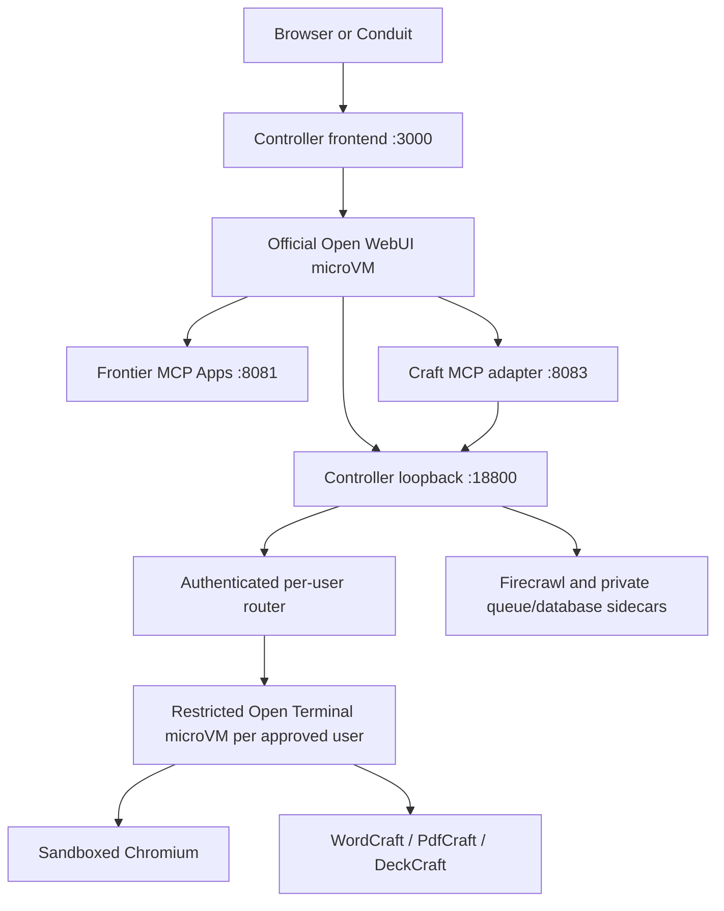

# Architecture and trust

Both WebUI and user VMs run through libkrun inside the controller's Docker namespace.
Only the controller receives `/dev/kvm`; no guest receives it, the Docker socket, the host
home, or another user's directory. Docker's default seccomp/AppArmor, dropped capabilities,
no-new-privileges and a read-only controller filesystem are retained. This trusted controller
has access to its installation data; it is not an untrusted agent workspace.

An exclusive installation lock prevents two controllers using the same runtime home.
On container startup, before any VM exists in the new PID namespace, a narrowly scoped
0.7.15 catalogue repair clears obsolete latest-run PIDs. Otherwise PID reuse could make
Microsandbox mistake another VM's new PID for an old runtime. The repair validates the
pinned schema, refuses live runtimes and leaves VM disks, configuration and cache intact.

The WebUI VM mounts only its data/configuration and shipped read-only adapters. User VMs
mount only their workspace, their own credential, shared read-only launch helpers and public
Craft binaries. Application core images remain official and unchanged.

The router accepts the native WebUI authenticated relay: protected router key plus
`X-User-Id`. It verifies approved/active UUID accounts using SQLite inside the WebUI guest,
avoiding delayed host-side visibility through virtiofs. It rejects unknown/pending/revoked
accounts, stops revoked VMs and retains their files. VMs are never assigned by caller path.

Craft uses an additional validated WebUI session and controller key. Each user/app has its
own serialized stdio MCP process inside that user's VM. Model-supplied names cannot select
host executables. Engine file-access roots constrain MCP reads/writes to `/home/user`.
Disconnects invalidate the session and return an ambiguous-outcome error, never automatic
replay. These sessions are shared across the same user's chats, so inspect active documents.

User VMs allow public HTTP/HTTPS and gateway DNS; private/LAN/metadata/host endpoints stay
blocked. WebUI additionally reaches the exact internal router port and any explicitly opted
in private model endpoint. Docker DNS and routes are installation-local; no host DNS is edited.

The frontend forwards only to WebUI. Control routes, API keys, backend ports, Craft stdio
processes, Firecrawl and databases are not published on host ports. Native terminal auth
frames and browser-view relay-header authentication remain distinct, including Conduit paths.

This is a single-host integration, not a hardened multi-tenant public hosting platform.
Persistent per-user disk quotas, idle VM eviction and production threat-model audits remain
operator work; capacity is bounded by `max_users` and host resources.
